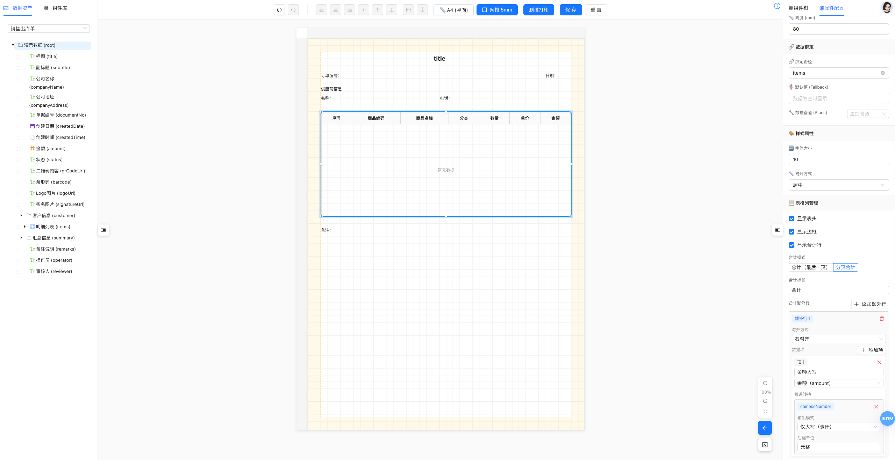
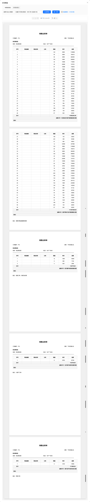

# Print Service Platform

English | [中文](./README.md)

**Current version**: v1.13.0 | **Codename**: Custom Group

A universal printing solution: a visual print-template designer plus a standalone, UI-agnostic print SDK ([`@jcyao/print-sdk`](https://www.npmjs.com/package/@jcyao/print-sdk)) for the browser.

---

## 🌐 Live Demo

**Demo URL**: https://printer-pi-five.vercel.app

Ships with sample schemas, templates and mock data — full functionality with no backend:
- Visual template designer (drag & drop, property editing, live preview)
- Template management (browse, edit and delete sample templates)
- Print preview and batch printing
- Mock data management

> The demo UI and built-in sample data are currently in Chinese only. Data is stored in browser memory and resets to the default samples on page refresh.

---

## 📋 Changelog

Each package maintains its own changelog:

- **SDK**: [sdk/CHANGELOG.md](./sdk/CHANGELOG.md) — full change history of the npm package `@jcyao/print-sdk` (in Chinese)
- **Designer**: iterates in sync with the SDK; see the related entries in the SDK changelog

---




## ✨ Key Features

### 1. Visual Template Designer

- **WYSIWYG drag-and-drop editing**
- ✅ Three-pane layout: data asset tree + canvas editor + property panel
- ✅ Three independent canvas regions (header / content / footer) with cross-region dragging
- ✅ Smart grid snapping (hold Shift to temporarily disable)
- ✅ Smart alignment guides (automatic alignment detection)
- ✅ Component tree panel (hierarchical view, quick locate)
- ✅ Undo / redo (Ctrl+Z / Ctrl+Shift+Z)
- ✅ Multi-page preview and real-time printing

### 2. Rich Component Library

- **Text**: labels, data binding, style configuration
- **Table**: cross-page pagination, repeating headers, column hiding, table totals
- **Image**: local / remote images, base64 encoding
- **QR code**: generated automatically
- **Barcode**: multiple barcode formats
- **Line**: solid / dashed styles
- **Rectangle**: border decoration

### 3. Powerful Data Binding

- ✅ Schema-driven data model
- ✅ Safe dot-path value access (`a.b.c`)
- ✅ Array fields automatically generate tables
- ✅ Array sub-fields smart-flagged (dragging disabled)
- ✅ Pipe transformation chains
- ✅ Default values for empty data

### 4. Pluggable Pipe System (Custom Pipes Supported)

8 built-in data transformation pipes; inject your own via `createPrintSDK({ customPipes })`:

| Pipe | Description | Typical use |
|---------|---------|---------|
| **Date formatting** | YYYY-MM-DD HH:mm:ss | Order dates |
| **Currency formatting** | ¥9999.00 | Amount display |
| **Money conversion** | cents↔dollars, thousands separators, Chinese uppercase amount | Backend cents to frontend dollars, accounting amounts |
| **Chinese uppercase numbers** | 壹仟, 叁点壹肆 (decimals supported) | Uppercase amounts and quantities |
| **Uppercase** | HELLO | Name capitalization |
| **Lowercase** | hello | Normalization |
| **String slice** | 138****8000 | Phone number masking |
| **Default value** | empty → "-" | Data fallback |

### 5. Advanced Print Engine

#### Relative-Gap Pagination Model

- ✅ Components laid out by relative gaps
- ✅ Automatic virtual pagination
- ✅ Smart cross-page table splitting
- ✅ Repeating table headers
- ✅ Precise page margin control
- ✅ **Page numbers**: 6 positions, 3 formats, custom styles

#### Advanced Table Features

- ✅ **Table totals**: SUM, AVG, MAX, MIN, COUNT, plus custom aggregators (runtime injection / override)
- ✅ **Table grouping**: render by group field, group headers, group subtotals, cross-page splits
- ✅ **Total modes**: grand total (last page) / per-page totals
- ✅ **High-precision math**: decimal.js avoids floating-point errors
- ✅ **Total-row styling**: configurable background, font weight and size
- ✅ **Gap-aware**: total-row height is included in pagination

#### Pluggable Renderers

- ✅ Registry pattern
- ✅ One independent renderer per component type
- ✅ Easy to extend with new components
- ✅ Unified rendering context

### 6. Standalone SDK

- ✅ Pure TypeScript
- ✅ No UI dependency, usable on its own
- ✅ Browser printing
- ✅ Batch print preview
- ✅ Rollup build, ESM / CJS
- ✅ External dependencies: qrcode, jsbarcode, decimal.js

```typescript
// SDK usage
import { createPrintSDK } from '@jcyao/print-sdk';

const sdk = createPrintSDK();

await sdk.print({
  template: templateJson,
  data: orderData
});
```

---

## 🔧 Architecture

### Designer Stack

- **Framework**: React 18 + TypeScript
- **Build tool**: Vite 5
- **State management**: Zustand
- **UI library**: Ant Design 6
- **Code editor**: Monaco Editor

### SDK Stack

- **Build tool**: Rollup
- **Output formats**: ESM + CommonJS
- **Core dependencies**:
  - qrcode ^1.5.4 — QR code generation
  - jsbarcode ^3.12.3 — barcode generation
  - decimal.js ^10.6.0 — high-precision arithmetic

### Design Patterns

- **Registry pattern**: pipe system, renderer system
- **Plugin architecture**: component renderers
- **Layered architecture**: SDK layer / Designer layer / Service layer
- **Executor / configurator separation**: logic decoupled from UI

---

## 📦 Project Structure

```
/printer
├── sdk/                    # Print SDK (standalone npm package @jcyao/print-sdk)
│   ├── src/
│   │   ├── printEngine/    # Print engine core
│   │   │   ├── renderers/  # Component renderer plugins (8)
│   │   │   ├── utils/      # Utilities
│   │   │   ├── htmlTemplate.ts
│   │   │   └── constants.ts
│   │   ├── pipes/          # Pipe system (8 built-in pipes)
│   │   │   ├── executors/  # Pipe executors
│   │   │   ├── registry.ts # Registry
│   │   │   └── types.ts    # Type definitions
│   │   ├── PrintSDK.ts     # SDK main class
│   │   ├── index.ts        # SDK entry
│   │   └── types.ts        # Global types
│   ├── CHANGELOG.md        # Version history
│   └── package.json
│
├── designer/               # Visual designer (Vite + React, private package)
│   ├── mock/               # Mock API data
│   ├── src/
│   │   ├── pages/
│   │   │   ├── Designer/           # Visual designer (full screen)
│   │   │   │   └── components/
│   │   │   │       ├── AssetPanel/     # Asset panel (data assets + component library)
│   │   │   │       ├── Canvas/         # Canvas editor
│   │   │   │       ├── PropertyPanel/  # Property configuration panel
│   │   │   │       ├── ComponentTreePanel/  # Component tree panel
│   │   │   │       └── DebugPanel/     # Debug panel
│   │   │   ├── TemplateManagement/ # Template management page
│   │   │   ├── SchemaManagement/   # Schema management page
│   │   │   └── MockDataManagement/ # Mock data management page
│   │   ├── components/         # Shared components (PrintPreview, Barcode, QRCode)
│   │   ├── pipes/configurators/  # Pipe configurators (UI)
│   │   ├── layouts/            # Layout components
│   │   ├── store/              # Zustand state
│   │   └── services/           # API services + mockStore
│   └── package.json
│
└── docs/                   # Documentation
    ├── 技术架构文档(仅参考).md
    ├── bugs/               # Bug records
    └── screenshot assets
```

---

## 📊 Stats

### Code Size

- **SDK source**: ~4,000 lines of TypeScript
- **Designer source**: ~12,800 lines of TypeScript + React

### Component Counts

- **Core components**: 7 (page numbers are a page-level config, not a component)
- **Built-in pipes**: 8
- **Renderer plugins**: 8 (including PageNumberRenderer)

### Feature Completeness

| Module | Status | Notes |
|------|--------|------|
| Visual designer | 100% | Three-region canvas, header/footer support |
| Print engine | 100% | Page numbers, header/footer pagination |
| Pipe system | 100% | Pluggable + custom pipe adapters |
| Table features | 100% | Totals, cross-page, precision |
| SDK | 100% | Standalone, batch printing, custom pipes |
| Sample templates | 100% | 3 samples included |

---

## 🚀 Quick Start

### Option 1: Run the Designer

```bash
cd designer
npm install
npm run dev
# Designer runs at http://localhost:5173
# Mock API is integrated into Vite — no separate backend needed
```

Designer routes:

| Path | Purpose |
|------|------|
| `/templates` | Template management (default home) |
| `/schemas` | Schema dictionary |
| `/mock-data` | Mock data management |
| `/designer` | Visual designer (full screen) |
| `/help` | User manual |

### Option 2: Build the SDK

```bash
cd sdk
npm install
npm run build
# Outputs dist/index.js and dist/index.esm.js
```

Shortcut scripts at the repo root:

```bash
npm run start            # Start the designer
npm run build:sdk        # Build the SDK
npm run build:designer   # Build the designer
```

---

## 📚 Usage Guide

### Create a Print Template

1. Open the designer (http://localhost:5173)
2. Pick a schema from the data asset tree on the left
3. Drag fields onto the canvas to create components
4. Configure styles and pipes in the property panel on the right
5. Click "Test Print" to preview
6. Save the template

### Integrate the SDK

```typescript
import { createPrintSDK } from '@jcyao/print-sdk';

// Create an SDK instance
const sdk = createPrintSDK();

// Print
await sdk.print({
  template: {
    pageConfig: { size: 'A4', orientation: 'portrait', marginMm: { ... } },
    components: [ ... ]
  },
  data: {
    orderNo: 'SR202401',
    items: [ ... ]
  }
});
```

---

## 🔮 Roadmap

### Planned Features

- ⏳ **Page-break component**: manual control of page breaks
- ⏳ **Widow / orphan control**: avoid single lines stranded across pages

### Enhancements

- More component types (watermark, signature box)
- Template versioning
- Template sharing and import/export
- Batch printing improvements

### Performance

- Virtual scrolling for large tables
- Image lazy loading and preloading
- Print queue management
- Caching strategy improvements

---

## 📄 License

MIT License

---

## 📮 Contact

- **Maintainer**: joke_yao
- **Technical reference**: `/docs/技术架构文档(仅参考).md` (in Chinese)

---

**Status**: ✅ Production Ready